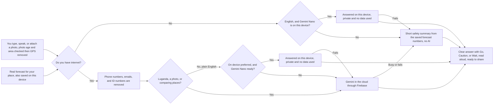
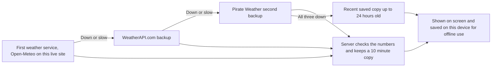
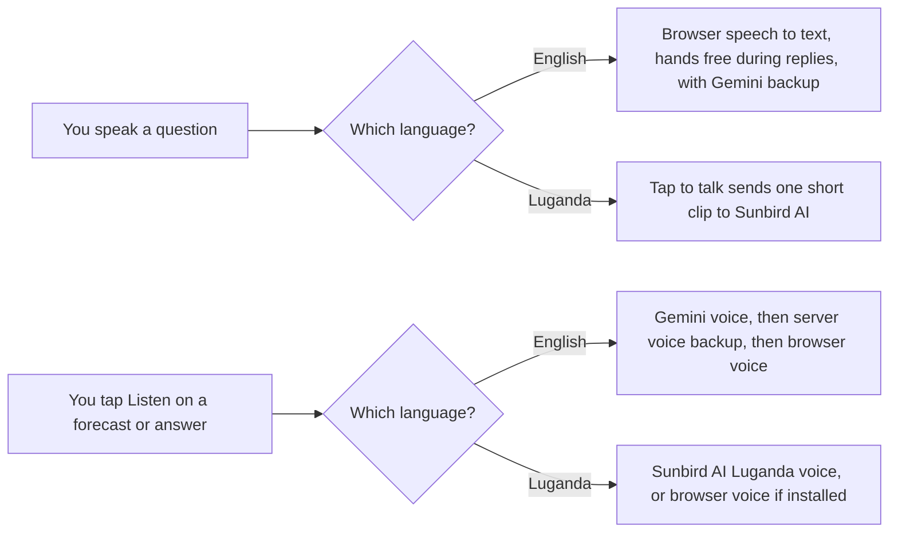

<p align="center">
  
</p>

<h1 align="center">Uganda Weather (Hybrid AI Edition)</h1>

<p align="center">
  Weather for every district, town, village, lake, park, and mountain in Uganda, with a safety advisor that answers in English and Luganda, online and offline.
</p>

<p align="center">
  <a href="https://hybrid.uganda-weather.com"><strong>Open the live app</strong></a>
  &nbsp;|&nbsp;
  <a href="#how-it-works">How it works</a>
  &nbsp;|&nbsp;
  <a href="#try-it-offline">Try it offline</a>
  &nbsp;|&nbsp;
  <a href="#run-it-on-your-computer">Run it yourself</a>
  &nbsp;|&nbsp;
  <a href="./LICENSE">MIT License</a>
</p>


This is the Hybrid AI edition, live at [hybrid.uganda-weather.com](https://hybrid.uganda-weather.com). It is kept separate from the main site, `uganda-weather.com`.

Tip. GitHub opens links in the same tab. Hold Cmd (Mac) or Ctrl (Windows) while clicking to open one in a new tab.

## Why I built this

In Uganda, the weather decides whether a family eats, earns, or gets home safely.

- Most families farm. About 68% to 70% of working people in Uganda are in farming ([US Commerce guide citing UBOS](https://www.trade.gov/country-commercial-guides/uganda-agricultural-sector)), and less than 1% of farmland is watered by irrigation ([FAO](https://www.fao.org/fileadmin/user_upload/agwa/docs/NIP-Uganda-Final.pdf)). Maize, beans, and coffee are dried outside in the sun, and one sudden shower can spoil a season's work.
- Fishers face sudden storms. The International Red Cross estimates that 3,000 to 5,000 fishers die in storms on Lake Victoria every year ([NASA](https://climate.nasa.gov/news/2500/lake-victoria-hazardous-thunderstorm-study-could-improve-climate-forecasts-around-us)), though other studies give lower numbers. When the WMO HIGHWAY project gave lakeside communities simple local warnings, studies estimated that weather deaths on the lake fell by about 30% ([WMO](https://wmo.int/node/13801)).
- Mountain and dry areas have their own dangers. Days of heavy rain around Mount Elgon and the Rwenzori slopes can trigger deadly landslides. In Karamoja, long hot dry spells put cattle, goats, and water points under stress.
- Not everyone can read. The 2024 census counted 45.9 million Ugandans. About one in four people aged 10 and older cannot read or write, and in Karamoja only 25% can ([UBOS census report](https://statistics.ubos.org/nphc/reports/National-Population-and-Housing-Census-2024-Final-Report-Volume-1-Main.pdf)). People with sight loss, hearing loss, or albinism (where strong sun causes serious sunburn) need weather they can hear or see at a glance.
- Most phones are not smartphones. Only about 34% of phones in Uganda are smartphones ([UCC figures reported by PC Tech Magazine](https://pctechmag.com/2025/12/ucc-report-ugandas-digital-footprint-grows-modestly-in-q3-2025/)). Data costs money, and the signal often drops in the garden, at the landing site, or on the mountain road.

An app that only works online, only in English, and only on expensive phones stops helping at exactly the wrong moment. This edition is built for the person with the weakest phone and the worst signal.

## What it does

- **It answers offline on any phone.** Open the app once while you have signal and the forecast is saved on your device. With no signal, devices that have Gemini Nano get full AI answers in English. Every phone or computer without it gets a short safety summary built only from the saved forecast numbers, clearly marked as made without AI.
- **It never leaves you with an error.** If the cloud AI is busy or fails, you still get the same forecast summary instead of an error message.
- **It speaks Luganda and English.** Luganda questions go to Gemini in the cloud, because Gemini Nano only writes English.
- **It reads answers aloud.** One tap reads any answer in natural English or Luganda, for people who cannot read.
- **It gives a clear verdict.** Every answer starts with Go, Caution, or Wait, so deaf and hard of hearing people, and anyone in a hurry, can see the answer at a glance.
- **It checks your photos.** Take a picture of the sky or a field. The app checks the photo is recent and from your area, and strips the hidden location data from it before sending.
- **It works on basic phones.** A low data `/lite` page works on screens as small as 240 by 320 pixels, with large text and high contrast switches.
- **It shares by SMS or WhatsApp.** One smartphone owner can forward the forecast to neighbours on basic phones. On phones, an SMS button sends it as one plain text message.

## Screenshots

| Offline answer from the saved forecast | Answers in Luganda | The low data page for basic phones |
| :---: | :---: | :---: |
|  |  |  |
| Switch to Offline from the button at the top of the advisor. Even without an on device AI model, you get an answer, marked Saved forecast. | Ask in Luganda and get an answer in Luganda, with a button to hear it read aloud. | A light page for basic phones, with voice reading, SMS and WhatsApp sharing, and big text. |

## How it works

The advisor is built on **Firebase AI Logic**, with **Firebase Remote Config** and **Firebase App Check**. It always answers from the app's own real forecast, never from the AI's memory.



The forecast itself comes from three weather services in order, with saved copies so temporary outages do not leave a blank screen.



The routing lives in `src/lib/ai/hybrid-advisor.ts`. It picks a Firebase AI Logic inference mode for every question.

```ts
const needsCloudForLanguage = generationLanguage === "lg";
const mode = !isOnline
  ? InferenceMode.ONLY_ON_DEVICE
  : hasImage || shouldEnableTools || needsCloudForLanguage
    ? InferenceMode.ONLY_IN_CLOUD
    : remoteConfig.preferOnDevice
      ? InferenceMode.PREFER_ON_DEVICE
      : InferenceMode.PREFER_IN_CLOUD;

const model = getGenerativeModel(ai, {
  mode,
  inCloudParams: { model: cloudModelName, systemInstruction, safetySettings },
  onDeviceParams: { createOptions: { expectedOutputs: [{ type: "text", languages: ["en"] }] } },
});
```

Each answer shows where it came from (On device, Cloud, or Saved forecast). That label is read from the `inferenceSource` that Firebase AI Logic returns.

Here is more of what Firebase does in this app.

- Answers stream in word by word, and you can stop them.
- When you compare two districts, the cloud model can look up the second district by itself (function calling).
- Every weather answer carries a Go, Caution, or Wait safety verdict checked against the forecast rain and wind thresholds.
- The rules the AI follows can be stored on Firebase as server prompt templates, so they do not ship inside the app.
- Remote Config lets me change the AI model or the voice, or pause the advisor, without releasing a new version (`src/lib/ai/remote-config.ts`, `remoteconfig.template.json`).
- App Check with reCAPTCHA Enterprise makes sure the AI is only used by this app.
- The English voice comes from Gemini through Firebase AI Logic, with a server voice backup and your browser's own voice after that, plus hands free listening while a reply plays so you can say a choice or stop at any time. Luganda voice is tap to talk and read aloud through Sunbird AI so replies are never sent for paid transcription.



The summary used when no AI can answer is in `src/lib/ai/offline-briefing.ts`. The privacy checks are in `src/lib/ai/advisor-guard.ts` and `src/lib/ai/advisor-image.ts`.

## Keeping it safe and fair to use

- Voice clips are never fetched just because a page opened, only when you tap, focus, or point at Listen, so nobody pays for data on page load.
- The paid voice routes refuse requests from other websites and have a monthly spending ceiling.
- Each part of the app has its own request limit, so many people sharing one mobile network are not blocked together.
- A forecast sent by SMS uses only basic SMS characters, so it costs one message, not three.

## What existed before, and what I built for the hackathon

Uganda Weather existed before November 11, 2026, as a weather site and app for all 152 districts, with towns, villages, lakes, parks, mountains, airport weather, and English and Luganda screens. That is what keeps the advisor honest. It answers from real Ugandan forecasts and known local dangers.

Between November 11 and 30, 2026, I built

- the whole Hybrid AI Weather Safety Advisor on Firebase AI Logic, with routing, streaming, function calling, safety verdicts, server prompt templates, Remote Config, and App Check,
- answers that still work offline on phones without an AI model, and when the cloud AI fails,
- the privacy protections for questions and photos,
- English and Luganda read aloud, hands free voice in English, and tap to talk voice in Luganda,
- the photo checks and the live camera,
- the low data page, SMS and WhatsApp sharing, the large text and high contrast switches, and community safety warnings (sun protection for people with albinism, livestock heat and water in Karamoja, and landslide watch on mountain slopes),
- layouts checked from tiny feature phone screens to desktop,
- and 748 automated unit tests plus 40 browser tests.

## Try it offline

Without Gemini Nano (on any phone, or in Chrome without the setting below), open the advisor, tap the button at the top, and choose Offline. Ask a question. You get a safety summary marked Saved forecast. This is what most people in rural Uganda will see.

To see Gemini Nano answer on your own computer, use desktop Chrome with at least 22 GB of free disk space.

1. Open `chrome://flags/#prompt-api-for-gemini-nano` and `chrome://flags/#optimization-guide-on-device-model`, set both to Enabled, and restart Chrome.
2. Open `chrome://on-device-internals` and wait until the model is ready.
3. Open [hybrid.uganda-weather.com](https://hybrid.uganda-weather.com), open the green advisor button, switch to Offline, and ask a question. The answer is marked On device.

## Run it on your computer

```bash
pnpm install
cp .env.example .env.local
```

Then put your Firebase web settings in `.env.local`.

- `NEXT_PUBLIC_FIREBASE_API_KEY`, `NEXT_PUBLIC_FIREBASE_PROJECT_ID`, and `NEXT_PUBLIC_FIREBASE_APP_ID` are needed for the AI advisor.
- `NEXT_PUBLIC_FIREBASE_RECAPTCHA_ENTERPRISE_SITE_KEY` turns on App Check. While testing, you can use `NEXT_PUBLIC_FIREBASE_APPCHECK_DEBUG_TOKEN=true` instead.
- `WEATHERAPI_KEY` is optional. Without it the app uses Open-Meteo, which needs no key.
- `WEATHER_PRIMARY_PROVIDER=open-meteo` asks Open-Meteo first and keeps WeatherAPI as the backup. This is what the live hybrid site does.

Start the app.

```bash
pnpm dev
```

Without any Firebase settings, the weather and the offline summary still work. Only the AI answers need Firebase.

## Checks before a pull request

```bash
pnpm lint && pnpm typecheck && pnpm test && pnpm build && pnpm guards
```

The browser tests run with `pnpm test:e2e`.

## What it is built with

- The app is Next.js 15, React 19, and TypeScript, styled with Tailwind CSS 4.
- The AI uses Firebase AI Logic, Firebase Remote Config, and Firebase App Check.
- Forecasts come from Open-Meteo and WeatherAPI.com (either can go first, with the other as the backup), with Pirate Weather as a third backup. Air quality comes from OpenWeatherMap, normal temperatures from Visual Crossing, airport weather from NOAA, villages and towns from OpenData Uganda, and radar from RainViewer.
- The same web app is also wrapped as Android and iOS apps with Capacitor, with home screen widgets. Those apps load the website, so the AI advisor described here is the web (Chrome) version.
- The API is described in [`openapi.yaml`](./openapi.yaml).

## Folders

```text
uganda-weather/
├── android/            # Android app and six home screen widgets
├── data/districts/     # All 152 districts and their map points
├── e2e/                # Automated browser tests
├── ios/                # iPhone app and six home screen widgets
├── public/             # Icons, offline page, and screenshots
├── scripts/            # Data builders and safety check scripts
├── openapi.yaml        # Description of the public weather and district routes
└── src/                # Pages, server routes, and the Weather Safety Advisor
```

## More

- How to help with the project is in [`CONTRIBUTING.md`](./CONTRIBUTING.md).
- How to report a security problem is in [`SECURITY.md`](./SECURITY.md).
- What changed and when is in [`CHANGELOG.md`](./CHANGELOG.md).
- The code is under the [MIT License](./LICENSE).

Uganda Weather uses forecast data from other providers. It is not an official UNMA service.

Built by [MCraft](https://www.mcraftportfolio.dev/).
