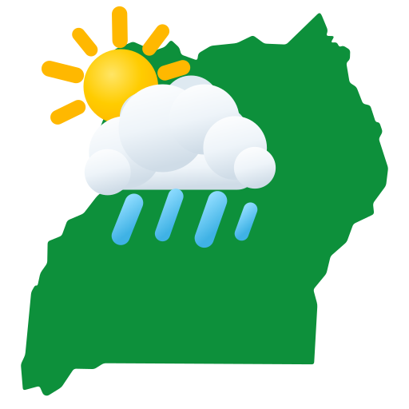
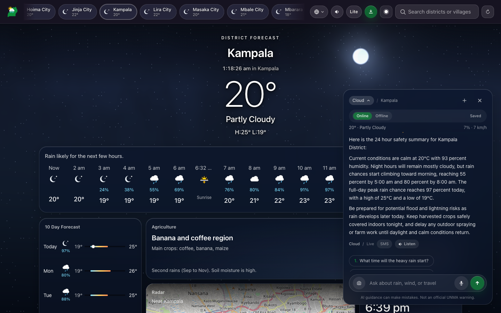
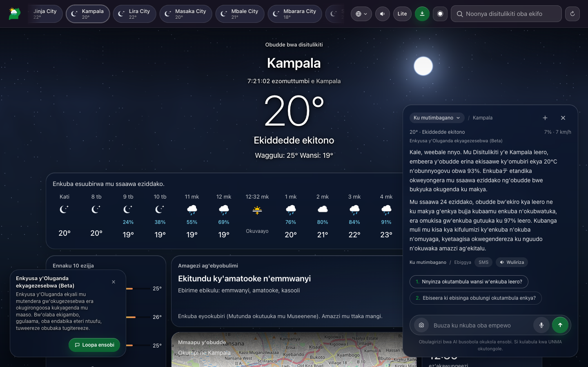
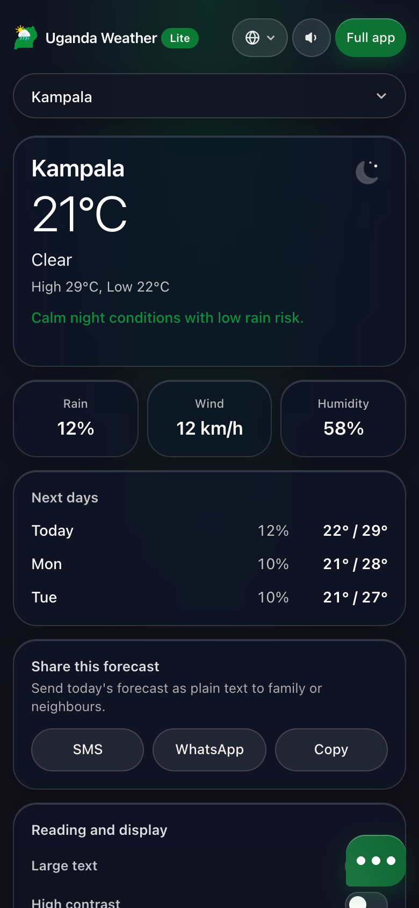
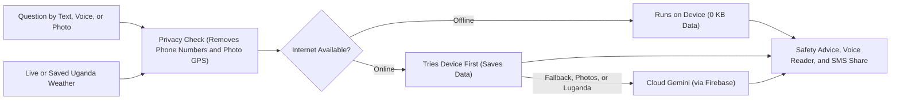

<p align="center">
  
</p>

<h1 align="center">Uganda Weather (Hybrid AI Edition)</h1>

<p align="center">
  Live weather for every district, town, village, lake, park, and mountain in Uganda, with an English and Luganda Weather Safety Advisor that works both online and offline.
</p>

<p align="center">
  <a href="https://hybrid.uganda-weather.com"><strong>Live App (hybrid.uganda-weather.com)</strong></a>
  &nbsp;|&nbsp;
  <a href="#how-hybrid-ai-works">Architecture</a>
  &nbsp;|&nbsp;
  <a href="#testing-on-device-mode-in-chrome">Offline Testing</a>
  &nbsp;|&nbsp;
  <a href="#running-locally">Run Locally</a>
  &nbsp;|&nbsp;
  <a href="./LICENSE">MIT License</a>
</p>


This repository is the standalone Hybrid AI edition live at [hybrid.uganda-weather.com](https://hybrid.uganda-weather.com), kept separate from `uganda-weather.com`.

## Why I built this

In Uganda, weather decides whether a family eats, earns a living, or gets home safely.

- **Farming families:** World Bank, FAO, and Uganda Bureau of Statistics (UBOS) data show that about 70% of Uganda's workforce depends on rain-fed farming, and only about 1.3% of farmland has irrigation. Most small farmers dry their maize, beans, and coffee outside in the sun. When sudden rain or heavy dampness hits drying crops, families often lose 5% to 13% of their grain and 12% to 18% of their beans and oilseeds.
- **Fishers on Uganda's lakes:** On Lake Victoria, sudden night storms and strong winds catch wooden fishing boats far from shore. For years, 3,000 to 5,000 fishers died on the lake each year. When the World Meteorological Organization (WMO) ran its HIGHWAY project and gave lakeside communities simple local warnings, storm deaths dropped by about 30%.
- **Mountain and dryland communities:** Around Mount Elgon (Bududa, Manafwa, Sironko, Bulambuli) and the Rwenzori slopes (Kasese, Bundibugyo), Makerere University studies show that heavy rain over a few days soaks steep hillsides and triggers deadly landslides. In Karamoja and the northern drylands, long hot dry spells put cattle, goats, and water points under severe stress.
- **Literacy, disability, and sun safety:** The **UBOS 2024 National Census** counted **45.9 million** Ugandans (51.4% female, 48.6% male). About **26% of people aged 10 and older cannot read or write**, and **13.2%** (about **5.5 million people** aged 2 and older) live with a disability, including sight loss, hearing loss, and albinism (where strong equatorial UV rays cause severe sunburn and high skin cancer risk).
- **Phones, data cost, and patchy signal:** Uganda Communications Commission (UCC) reports show about **18 to 19 million smartphones** (roughly 40% of phones), while **basic and feature phones ("kabiriti") still make up over half of all handsets**. **1 GB of mobile data costs around UGX 4,000 to UGX 5,000**, and rural signal drops often. Many people check their phone in town, then lose signal when they reach their garden, landing site, or mountain road.

A cloud only app stops helping the moment mobile signal drops, and a text only app leaves out people who cannot read or afford big data bundles. I built **Uganda Weather (Hybrid AI Edition)** to solve all of these real constraints together:

- **Works online and offline:** Load your district forecast once while you have signal, save it on the phone, and ask practical safety questions offline in plain English using on-device Gemini Nano (`0 KB` cloud data), or get live cloud answers in English and Luganda when online.
- **Built for eyes, ears, and basic phones:** One-tap natural voice briefings in English and Luganda for blind and non-reading users, clear visual Go / Caution / Wait cards for deaf and hard-of-hearing users, `Large text` and `High contrast` display switches, a fast low-data `/lite` mode tested on `240x320` KaiOS feature phones and `320x568` Android Go devices, and one-tap **SMS** and **WhatsApp** plain-text sharing so one smartphone owner can forward the full forecast or safety verdict to family and neighbours on 2G button phones for free.

## Screenshots

| Online / Offline Switch & Saved Forecast | Bilingual Luganda Guidance | Feature Phone Lite Mode & SMS Share |
| :---: | :---: | :---: |
|  |  |  |
| Tap the top left status pill (`Cloud` or `On device`) to switch directly between `Online` and `Offline` mode and confirm your local forecast is saved. | Works naturally in both English and Luganda, including switching languages in the middle of a conversation. | Fast low data `/lite` mode built for basic and feature phones, with one tap voice reading, plain text SMS and WhatsApp sharing, and large text controls. |

## How Hybrid AI works

The advisor uses **Firebase AI Logic**, **Firebase Remote Config**, and **Firebase App Check**, backed by the app's own live and saved weather data so it never guesses the weather.



Under the hood, `src/lib/ai/firebase-client.ts`, `src/lib/ai/hybrid-advisor.ts`, `src/lib/ai/template-advisor.ts`, and `src/lib/ai/firebase-tts.ts` connect to Firebase AI Logic with Firebase App Check and Firebase Remote Config, choosing phone or cloud automatically:

```ts
const ai = getAI(app, {
  backend: new GoogleAIBackend(),
  useLimitedUseAppCheckTokens: false,
});

const mode = !isOnline
  ? InferenceMode.ONLY_ON_DEVICE
  : hasImage || shouldEnableTools
    ? InferenceMode.ONLY_IN_CLOUD
    : remoteConfig.preferOnDevice
      ? InferenceMode.PREFER_ON_DEVICE
      : InferenceMode.PREFER_IN_CLOUD;

const model = getGenerativeModel(ai, {
  mode,
  inCloudParams: { model: remoteConfig.cloudModel, safetySettings },
});
```

Before sending a question to the model, `src/lib/ai/advisor-prompt.ts`, `src/lib/ai/advisor-guard.ts`, and `src/lib/ai/advisor-image.ts` protect user privacy and keep every answer tied to real weather numbers:

- **Privacy built in:** Everyday English questions for one district run on your phone first (using Gemini Nano) so your plans stay private and use `0 KB` of mobile data. Before any question goes to the cloud, the app automatically removes phone numbers, emails, and ID numbers, and strips hidden GPS location data from sky or crop photos on your phone.
- **Server side prompt templates:** Supports running cloud answers from Firebase Console Server Prompt Templates (`getTemplateGenerativeModel` and `advisor_prompt_template_id` in Remote Config), keeping prompt rules safely on Firebase servers.
- **Natural voice reader in English and Luganda:** Reads weather briefings and answers aloud in clear English (via Firebase AI Logic audio) and natural Luganda (via Sunbird AI), splitting long text into short sentences and pre loading the start so speech begins fast, with browser speech as the offline backup.
- **Built for everyone and basic phones:** Low data `/lite` mode tested on `240x320` KaiOS feature phones and `320x568` Android Go phones, `Large text` and `High contrast` display switches, one tap plain text `SMS` and `WhatsApp` forecast sharing for neighbours on 2G basic phones, offline parish and town search caching, and community safety warnings (High UV sun protection including persons with albinism, Karamoja livestock heat and water watch, and 72 hour mountain slope landslide watch).
- **Exact place type and Uganda local time (EAT):** Tells National Parks, Mountains, Airports, Villages, Cities, and Districts apart, and follows Uganda local time so it never tells farmers to dry crops at night.
- **Live controls and abuse protection:** Firebase Remote Config (`src/lib/ai/remote-config.ts`, `remoteconfig.template.json`) lets us update models, voice settings, prompt templates, or pause the advisor live without redeploying. Firebase App Check (`ReCaptchaEnterpriseProvider`) and input checks block spam and misuse.

## What existed before and what I built for this submission

Uganda Weather already existed before November 11, 2026 as a web and mobile weather app covering all 152 Ugandan districts plus towns, villages, four major lakes, national parks, mountain peaks, airport weather, English and Luganda screens, and local forecast saving.

That existing app is what makes the Hybrid AI Advisor useful: instead of a chatbot guessing weather from memory, every answer is based on real live and saved Ugandan forecasts, known local hazards, and lake safety data.

During the submission period (November 11 to November 30, 2026), I built:

- **The Hybrid AI Advisor and Firebase setup:** Live streaming answers with a stop button, automatic privacy protection (removes phone numbers, emails, ID numbers, and hidden photo GPS before cloud requests), Firebase Remote Config live controls, Firebase App Check bot protection, server side prompt templates, and built in English neural voice (`src/lib/ai/`).
- **Hands free Voice Reader, Live Camera, and Feature Phone Lite Mode:** Tap once to listen to any screen or detail card in clear English or natural Luganda, talk hands free (say `one`, `two`, `emu`, `bbiri`, `stop`, or `lekera awo`, and interrupt cleanly by speaking), take a live sky or crop photo or upload from gallery (checking that the photo is recent and from Uganda), and use the fast, low data `/lite` page built for `240x320` KaiOS feature phones and `320x568` Android Go phones.
- **Everyday inclusion, safety, and polish:** Cleaner cards and readable text over bright skies, `Large text` and `High contrast` switches that do not resize cards, one tap `SMS` and `WhatsApp` plain text forecast sharing for neighbours on 2G basic phones, offline search across all 152 districts plus cached parishes and major Ugandan towns, community safety warnings (High UV sun protection including persons with albinism, Karamoja livestock heat and water watch, and 72 hour mountain slope landslide watch), and 596 automated unit tests across 108 files plus 9 feature phone and mobile tests.

## Testing On-Device Mode in Chrome

1. Open Chrome on a desktop machine with at least 22 GB of free disk space and enable `chrome://flags/#prompt-api-for-gemini-nano` (restart Chrome if prompted).
2. Visit `chrome://on-device-internals` to verify Gemini Nano is downloaded and ready.
3. Open [https://hybrid.uganda-weather.com](https://hybrid.uganda-weather.com) (or `http://localhost:3000`), open the green chat button, tap the status pill (`Cloud` or `On device`), and switch to **`Offline`** (or turn on Offline in Chrome DevTools) to run `InferenceMode.ONLY_ON_DEVICE` against your locally saved district forecast.

## Running locally

```bash
pnpm install
cp .env.example .env.local
```

Add your Firebase Web keys to `.env.local`:

- `NEXT_PUBLIC_FIREBASE_API_KEY`
- `NEXT_PUBLIC_FIREBASE_PROJECT_ID`
- `NEXT_PUBLIC_FIREBASE_APP_ID`
- Optional: `NEXT_PUBLIC_FIREBASE_RECAPTCHA_ENTERPRISE_SITE_KEY` or `NEXT_PUBLIC_FIREBASE_APPCHECK_DEBUG_TOKEN=true` for App Check, and `NEXT_PUBLIC_FIREBASE_AI_MODEL` for the default cloud model.
- Optional: `WEATHERAPI_KEY` for primary weather data (without it, the app uses Open-Meteo, which needs no key).

Start the app:

```bash
pnpm dev
```

## Quality checks

Run the full check suite locally before opening a pull request:

```bash
pnpm lint && pnpm typecheck && pnpm test && pnpm build && pnpm guards
```

## Tech stack

- **Frontend:** Next.js 15, React 19, TypeScript, Tailwind CSS 4, TanStack Query, Zustand, Framer Motion
- **Hybrid AI:** Firebase AI Logic (`firebase/ai`), Firebase Remote Config (`firebase/remote-config`), Firebase App Check (`firebase/app-check`)
- **Backend and caching:** Next.js API routes with Upstash Redis (in memory fallback in development)
- **Weather and place data:** WeatherAPI.com, Open-Meteo, Pirate Weather, OpenWeatherMap (air quality), Visual Crossing (historical averages), NOAA Aviation Weather Center (airport METAR), OpenData Uganda v1 (villages and towns), RainViewer (radar), MapTiler and Stadia Maps
- **Mobile shells:** Capacitor 7 for Android and iOS with six home screen widgets
- **API contract:** [`openapi.yaml`](./openapi.yaml)

## Native mobile builds

The mobile shells load the hosted web app over HTTPS:

```bash
CAPACITOR_SERVER_URL=https://hybrid.uganda-weather.com pnpm cap:prepare
CAPACITOR_SERVER_URL=https://hybrid.uganda-weather.com pnpm cap:add:android
CAPACITOR_SERVER_URL=https://hybrid.uganda-weather.com pnpm cap:add:ios
```

Device signing, push credentials, and platform service config are supplied by the release environment and are never committed to this repo.

## Project structure

```text
uganda-weather/
├── data/districts/     # Uganda district dataset and centroid cache
├── public/screenshots/ # Live app screenshots
├── scripts/            # Dataset build and guard scripts
├── openapi.yaml        # API contract
└── src/                # Next.js app and Hybrid AI Weather Safety Advisor
```

## Contributing, Security, and License

- Contributing: [`CONTRIBUTING.md`](./CONTRIBUTING.md)
- Security: [`SECURITY.md`](./SECURITY.md)
- Changelog: [`CHANGELOG.md`](./CHANGELOG.md)
- License: [MIT](./LICENSE)

Uganda Weather uses third party forecast data. Not an official UNMA service.

Built by [MCraft](https://www.mcraftportfolio.dev/).
