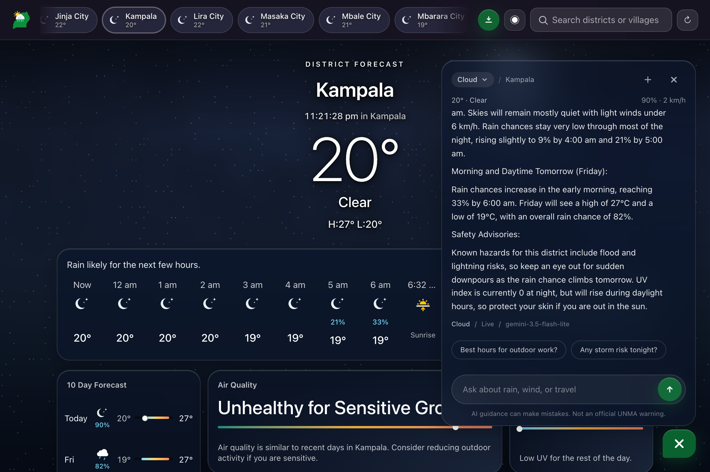
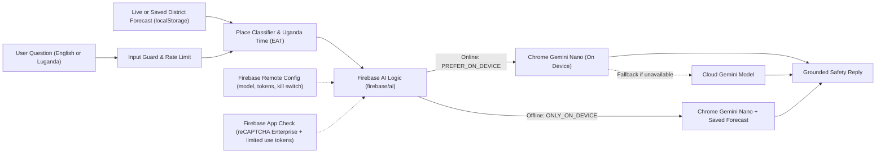

<p align="center">
  
</p>

<h1 align="center">Uganda Weather (Hybrid AI Edition)</h1>

<p align="center">
  Live weather for every district, town, village, lake, park, and mountain in Uganda, with an English and Luganda Weather Safety Advisor that works both online and offline.
</p>

<p align="center">
  <a href="https://hybrid.uganda-weather.com"><strong>Live App (hybrid.uganda-weather.com)</strong></a>
  &nbsp;|&nbsp;
  <a href="#how-hybrid-ai-works">Architecture</a>
  &nbsp;|&nbsp;
  <a href="#testing-on-device-mode-in-chrome">Offline Testing</a>
  &nbsp;|&nbsp;
  <a href="#running-locally">Run Locally</a>
  &nbsp;|&nbsp;
  <a href="./LICENSE">MIT License</a>
</p>



This repository is the standalone Hybrid AI edition live at [hybrid.uganda-weather.com](https://hybrid.uganda-weather.com), kept separate from `uganda-weather.com`.

## Why I built this

In Uganda, weather affects food, work, and safety every single day.

According to the World Bank, FAO, and Uganda Bureau of Statistics (UBOS), more than 8 out of 10 farming families in Uganda depend on rain, and only about 1.3% of farmland has irrigation. Most farmers work small plots and dry their beans, maize, and coffee outside in the sun. When sudden rain or high humidity hits crops drying outside, farmers lose a big part of their harvest (often 5% to 13% for grains and 12% to 18% for beans and oilseeds).

The same problem happens on the lakes and in the mountains. On Lake Victoria, sudden storms and strong winds often start late at night when wooden fishing boats are far from shore. For years, between 3,000 and 5,000 fishers died on the lake every year. When the World Meteorological Organization (WMO) ran its HIGHWAY project and gave lakeside communities simple local warnings, deaths from lake storms dropped by about 30%. Around Mount Elgon, in places like Bududa, Sironko, Bulambuli, and Namisindwa, Makerere University studies show that heavy rain of around 100 mm over a short time can soak the soil and trigger deadly landslides.

Internet access makes this even harder. Uganda has more than 40 million active mobile lines, yet DataReportal and Uganda Communications Commission (UCC) reports show that only about 22% of people regularly use the internet. Outside main towns, mobile data is expensive, signal drops easily, and power cuts are common. Many people check their phone in town, then lose signal when they reach their farm, landing site, or mountain road.

An assistant that only works in the cloud stops helping the moment signal disappears. I built the Hybrid Weather Safety Advisor so people can load their local forecast once while they have signal, keep it saved on their device, and still ask practical safety questions offline in simple English or Luganda. When they are back online, they get live cloud answers too.

## Screenshots

| Online / Offline Switch & Saved Forecast | Bilingual Luganda Guidance |
| :---: | :---: |
|  |  |
| Tap the top left status pill (`Cloud` or `On device`) to switch directly between `Online` and `Offline` mode and confirm your local forecast is saved. | Works naturally in both English and Luganda, including switching languages in the middle of a conversation. |

## How Hybrid AI works

The advisor uses **Firebase AI Logic**, **Firebase Remote Config**, and **Firebase App Check**, backed by the app's own live and saved weather data so it never guesses the weather.



At runtime, `src/lib/ai/firebase-client.ts` and `src/lib/ai/hybrid-advisor.ts` initialize Firebase AI Logic with replay protected App Check tokens and switch inference modes based on connectivity:

```ts
const ai = getAI(app, {
  backend: new GoogleAIBackend(),
  useLimitedUseAppCheckTokens: isAppCheckActive(),
});

const mode =
  isOffline || !remoteConfig.preferOnDevice
    ? isOffline
      ? InferenceMode.ONLY_ON_DEVICE
      : InferenceMode.ONLY_IN_CLOUD
    : InferenceMode.PREFER_ON_DEVICE;

const model = getGenerativeModel(ai, {
  mode,
  inCloudParams: { model: remoteConfig.cloudModel, safetySettings },
});
```

Before sending a question to the model, `src/lib/ai/advisor-prompt.ts` prepares clean local facts:

- **Exact place type:** Checks whether you are viewing a National Park, Mountain peak, Airport, Exact GPS location, Village or town, City, or District so places like Mount Elgon or a village are never called a district.
- **Uganda local time (`EAT`):** Tells the model whether it is day or night so it never suggests drying crops after dark, and states the exact saved time when answering offline.
- **Cross district spelling match:** If you type something like `"What of Bukoma"`, it resolves `Bukomansimbi`, loads its live weather, and confirms the spelling before answering.
- **Safety and live controls:** Firebase Remote Config (`src/lib/ai/remote-config.ts`, `remoteconfig.template.json`) controls `advisor_enabled`, `advisor_cloud_model`, `advisor_max_output_tokens`, and `advisor_prefer_on_device` live with safe offline defaults. Enforced Firebase App Check (`ReCaptchaEnterpriseProvider` + `useLimitedUseAppCheckTokens`), model `safetySettings`, and `src/lib/ai/advisor-guard.ts` block abusive prompts, spam, and internal prompt leaks.

## What existed before and what I built for this submission

Uganda Weather already existed before November 11, 2026 as a web and mobile weather app covering all 152 Ugandan districts plus towns, villages, four major lakes, national parks, mountain peaks, airport weather, English and Luganda screens, and local forecast saving.

That existing app is what makes the Hybrid AI Advisor useful: instead of a chatbot guessing weather from memory, every answer is based on real live and saved Ugandan forecasts, known local hazards, and lake safety data.

During the submission period (November 11 to November 30, 2026), I built:

- **The Hybrid AI engine and Firebase setup:** `src/lib/ai/firebase-client.ts`, `hybrid-advisor.ts`, `remote-config.ts`, `advisor-prompt.ts`, `advisor-guard.ts`, `remoteconfig.template.json`, and `firebase.json`, with live streaming, a stop button (`AbortSignal`), automatic fallback if streaming fails, fast `ThinkingLevel.MINIMAL` replies, and enforced App Check.
- **The Weather Safety Advisor chat:** `src/components/advisor/HybridWeatherAdvisor.tsx`, `advisor-helpers.ts`, and `advisor-sound.ts`, with smart quick questions for each place, model labels after each reply, and a simple `Online` / `Offline` switch.
- **App wide visual and usability updates:** cleaner cards and sheets, matching text sizes, a bold red severe weather pill, clearer text over bright skies, a cleaner dropdown (`GlassSelect`), clickable parks, mountains, airports, lakes, and nearby districts, plus 531 automated tests across 95 test files.

## Testing On-Device Mode in Chrome

1. Open Chrome on a desktop machine with at least 22 GB of free disk space and enable `chrome://flags/#prompt-api-for-gemini-nano` (restart Chrome if prompted).
2. Visit `chrome://on-device-internals` to verify Gemini Nano is downloaded and ready.
3. Open [https://hybrid.uganda-weather.com](https://hybrid.uganda-weather.com) (or `http://localhost:3000`), open the green chat button, tap the status pill (`Cloud` or `On device`), and switch to **`Offline`** (or turn on Offline in Chrome DevTools) to run `InferenceMode.ONLY_ON_DEVICE` against your locally saved district forecast.

## Running locally

```bash
pnpm install
cp .env.example .env.local
```

Add your Firebase Web keys to `.env.local`:

- `NEXT_PUBLIC_FIREBASE_API_KEY`
- `NEXT_PUBLIC_FIREBASE_PROJECT_ID`
- `NEXT_PUBLIC_FIREBASE_APP_ID`
- Optional: `NEXT_PUBLIC_FIREBASE_RECAPTCHA_ENTERPRISE_SITE_KEY` or `NEXT_PUBLIC_FIREBASE_APPCHECK_DEBUG_TOKEN=true` for App Check, and `NEXT_PUBLIC_FIREBASE_AI_MODEL` for the default cloud model.
- Optional: `WEATHERAPI_KEY` for primary weather data (without it, the app uses Open-Meteo, which needs no key).

Start the app:

```bash
pnpm dev
```

## Quality checks

Run the full check suite locally before opening a pull request:

```bash
pnpm lint && pnpm typecheck && pnpm test && pnpm build && pnpm guards
```

## Tech stack

- **Frontend:** Next.js 15, React 19, TypeScript, Tailwind CSS 4, TanStack Query, Zustand, Framer Motion
- **Hybrid AI:** Firebase AI Logic (`firebase/ai`), Firebase Remote Config (`firebase/remote-config`), Firebase App Check (`firebase/app-check`)
- **Backend and caching:** Next.js API routes with Upstash Redis (in memory fallback in development)
- **Weather and place data:** WeatherAPI.com, Open-Meteo, Pirate Weather, OpenWeatherMap (air quality), Visual Crossing (historical averages), NOAA Aviation Weather Center (airport METAR), OpenData Uganda v1 (villages and towns), RainViewer (radar), MapTiler and Stadia Maps
- **Mobile shells:** Capacitor 7 for Android and iOS with six home screen widgets
- **API contract:** [`openapi.yaml`](./openapi.yaml)

## Native mobile builds

The mobile shells load the hosted web app over HTTPS:

```bash
CAPACITOR_SERVER_URL=https://hybrid.uganda-weather.com pnpm cap:prepare
CAPACITOR_SERVER_URL=https://hybrid.uganda-weather.com pnpm cap:add:android
CAPACITOR_SERVER_URL=https://hybrid.uganda-weather.com pnpm cap:add:ios
```

Device signing, push credentials, and platform service config are supplied by the release environment and are never committed to this repo.

## Project structure

```text
uganda-weather/
├── data/districts/     # Uganda district dataset and centroid cache
├── public/screenshots/ # Live app screenshots
├── scripts/            # Dataset build and guard scripts
├── openapi.yaml        # API contract
└── src/                # Next.js app and Hybrid AI Weather Safety Advisor
```

## Contributing, Security, and License

- Contributing: [`CONTRIBUTING.md`](./CONTRIBUTING.md)
- Security: [`SECURITY.md`](./SECURITY.md)
- Changelog: [`CHANGELOG.md`](./CHANGELOG.md)
- License: [MIT](./LICENSE)

Uganda Weather uses third party forecast data. Not an official UNMA service.

Built by [MCraft](https://www.mcraftportfolio.dev/).
