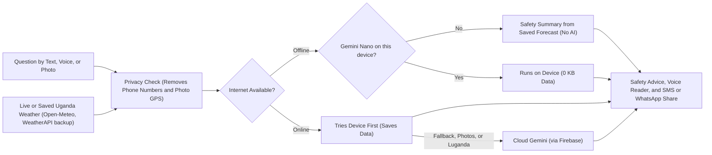

<p align="center">
  
</p>

<h1 align="center">Uganda Weather (Hybrid AI Edition)</h1>

<p align="center">
  Live weather for every district, town, village, lake, park, and mountain in Uganda, with an English and Luganda Weather Safety Advisor that works both online and offline.
</p>

<p align="center">
  <a href="https://hybrid.uganda-weather.com"><strong>Live App (hybrid.uganda-weather.com)</strong></a>
  &nbsp;|&nbsp;
  <a href="#how-hybrid-ai-works">Architecture</a>
  &nbsp;|&nbsp;
  <a href="#testing-on-device-mode-in-chrome">Offline Testing</a>
  &nbsp;|&nbsp;
  <a href="#running-locally">Run Locally</a>
  &nbsp;|&nbsp;
  <a href="./LICENSE">MIT License</a>
</p>


This repository is the standalone Hybrid AI edition live at [hybrid.uganda-weather.com](https://hybrid.uganda-weather.com), kept separate from `uganda-weather.com`.

## Why I built this

In Uganda, weather decides whether a family eats, earns a living, or gets home safely.

- **Farming families:** About 68% to 70% of Uganda's working population is in farming ([US Commerce guide citing UBOS](https://www.trade.gov/country-commercial-guides/uganda-agricultural-sector)), and less than 1% of cultivated land is equipped for irrigation ([FAO](https://www.fao.org/fileadmin/user_upload/agwa/docs/NIP-Uganda-Final.pdf)), so almost every harvest depends on the rain. Most small farmers dry maize, beans, and coffee outside in the sun, where a sudden shower can spoil a season's work.
- **Fishers on Uganda's lakes:** Sudden storms on Lake Victoria catch small wooden boats far from shore. The International Red Cross estimates 3,000 to 5,000 fishers die in storms on the lake each year ([NASA](https://climate.nasa.gov/news/2500/lake-victoria-hazardous-thunderstorm-study-could-improve-climate-forecasts-around-us)); other studies give lower numbers. When the World Meteorological Organization's HIGHWAY project gave lakeside communities simple local warnings, studies estimated weather deaths on the lake fell by about 30%, more than 300 lives a year ([WMO](https://wmo.int/node/13801)).
- **Mountain and dryland communities:** Around Mount Elgon (Bududa, Manafwa, Sironko, Bulambuli) and the Rwenzori slopes (Kasese, Bundibugyo), Makerere University studies show that heavy rain over a few days soaks steep hillsides and triggers deadly landslides. In Karamoja and the northern drylands, long hot dry spells put cattle, goats, and water points under severe stress.
- **Literacy, disability, and sun safety:** The 2024 national census counted 45.9 million Ugandans. 74% of people aged 10 and older can read and write, so about one in four cannot, falling to 25% literacy in Karamoja ([UBOS census final report](https://statistics.ubos.org/nphc/reports/National-Population-and-Housing-Census-2024-Final-Report-Volume-1-Main.pdf)). The same report puts disability at 5.7%, a figure disability groups and the government have publicly questioned. People with sight loss, hearing loss, and albinism (where strong equatorial sun causes severe sunburn) need weather information they can hear or see at a glance.
- **Phones and patchy signal:** Uganda Communications Commission figures for the third quarter of 2025 show feature phones are about 56% of devices, basic phones about 10%, and smartphones only about 34% ([PC Tech Magazine on the UCC report](https://pctechmag.com/2025/12/ucc-report-ugandas-digital-footprint-grows-modestly-in-q3-2025/)). Mobile data is a real cost for families and rural signal drops often: many people check their phone in town, then lose signal at the garden, landing site, or mountain road.

A cloud only app stops helping the moment mobile signal drops, and a text only app leaves out people who cannot read or afford big data bundles. I built **Uganda Weather (Hybrid AI Edition)** to solve all of these real constraints together:

- **Works online and offline, on any phone:** Load your district forecast once while you have signal and it is saved on the phone. Offline, every phone gets a plain safety summary built only from the saved forecast numbers (clearly labelled, no AI and no guessing). Devices that have Gemini Nano get full AI answers offline in English. Online, answers come from Gemini in the cloud in English and Luganda.
- **Built for eyes, ears, and basic phones:** One tap natural voice briefings in English and Luganda for blind and non reading users, clear Go / Caution / Wait labels for deaf and hard of hearing users, `Large text` and `High contrast` switches, a low data `/lite` page checked in automated tests at `240x320` and `320x568` screen sizes, and one tap **SMS** (on phones) and **WhatsApp** plain text sharing so one smartphone owner can forward the forecast to family and neighbours on basic phones.

## Screenshots

| Online / Offline Switch & Saved Forecast | Bilingual Luganda Guidance | Feature Phone Lite Mode & SMS Share |
| :---: | :---: | :---: |
|  |  |  |
| Switch to `Offline` from the status pill. With no internet and no on device model, the advisor still answers from the saved forecast, clearly labelled `Saved forecast`. | Works naturally in both English and Luganda, including switching languages in the middle of a conversation. | Fast low data `/lite` mode built for basic and feature phones, with one tap voice reading, plain text SMS and WhatsApp sharing, and large text controls. |

## How Hybrid AI works

The advisor uses **Firebase AI Logic**, **Firebase Remote Config**, and **Firebase App Check**, backed by the app's own live and saved weather data so it never guesses the weather.



Under the hood, `src/lib/ai/firebase-client.ts`, `src/lib/ai/hybrid-advisor.ts`, `src/lib/ai/template-advisor.ts`, and `src/lib/ai/firebase-tts.ts` connect to Firebase AI Logic with Firebase App Check and Firebase Remote Config, choosing phone or cloud automatically:

```ts
const ai = getAI(app, {
  backend: new GoogleAIBackend(),
  useLimitedUseAppCheckTokens: false,
});

const mode = !isOnline
  ? InferenceMode.ONLY_ON_DEVICE
  : hasImage || shouldEnableTools
    ? InferenceMode.ONLY_IN_CLOUD
    : remoteConfig.preferOnDevice
      ? InferenceMode.PREFER_ON_DEVICE
      : InferenceMode.PREFER_IN_CLOUD;

const model = getGenerativeModel(ai, {
  mode,
  inCloudParams: { model: remoteConfig.cloudModel, safetySettings },
});
```

Before sending a question to the model, `src/lib/ai/advisor-prompt.ts`, `src/lib/ai/advisor-guard.ts`, and `src/lib/ai/advisor-image.ts` protect user privacy and keep every answer tied to real weather numbers:

- **Privacy built in:** Everyday English questions for one district run on your phone first (using Gemini Nano) so your plans stay private and use `0 KB` of mobile data. Before any question goes to the cloud, the app automatically removes phone numbers, emails, and ID numbers, and strips hidden GPS location data from sky or crop photos on your phone.
- **Server side prompt templates:** Supports running cloud answers from Firebase Console Server Prompt Templates (`getTemplateGenerativeModel` and `advisor_prompt_template_id` in Remote Config), keeping prompt rules safely on Firebase servers.
- **Natural voice reader in English and Luganda:** Reads weather briefings and answers aloud in clear English (Gemini voice through Firebase AI Logic, with a server voice as backup) and natural Luganda (Sunbird AI). Speech is fetched only when you tap Listen, never on page load, so no data or quota is spent unless you ask. The browser's own voice, preferring its most natural voices, is the last backup.
- **Built for everyone and basic phones:** Low data `/lite` page checked in automated tests at `240x320` and `320x568` screen sizes, `Large text` and `High contrast` switches, one tap plain text `SMS` (on phones) and `WhatsApp` forecast sharing for neighbours on basic phones, offline parish and town search caching, and community safety warnings (High UV sun protection including persons with albinism, Karamoja livestock heat and water watch, and 72 hour mountain slope landslide watch).
- **Exact place type and Uganda local time (EAT):** Tells National Parks, Mountains, Airports, Villages, Cities, and Districts apart, and follows Uganda local time so it never tells farmers to dry crops at night.
- **Live controls and abuse protection:** Firebase Remote Config (`src/lib/ai/remote-config.ts`, `remoteconfig.template.json`) lets us update models, voice settings, prompt templates, or pause the advisor live without redeploying. Firebase App Check (`ReCaptchaEnterpriseProvider`) and input checks block spam and misuse.

## What existed before and what I built for this submission

Uganda Weather already existed before November 11, 2026 as a web and mobile weather app covering all 152 Ugandan districts plus towns, villages, four major lakes, national parks, mountain peaks, airport weather, English and Luganda screens, and local forecast saving.

That existing app is what makes the Hybrid AI Advisor useful: instead of a chatbot guessing weather from memory, every answer is based on real live and saved Ugandan forecasts, known local hazards, and lake safety data.

During the submission period (November 11 to November 30, 2026), I built:

- **The Hybrid AI Advisor and Firebase setup:** Live streaming answers with a stop button, automatic privacy protection (removes phone numbers, emails, ID numbers, and hidden photo GPS before cloud requests), Firebase Remote Config live controls, Firebase App Check bot protection, server side prompt templates, and built in English neural voice (`src/lib/ai/`).
- **Hands free Voice Reader, Live Camera, and Feature Phone Lite Mode:** Tap once to listen to any screen or detail card in clear English or natural Luganda, talk hands free (say `one`, `two`, `emu`, `bbiri`, `stop`, or `lekera awo`, and interrupt cleanly by speaking), take a live sky or crop photo or upload from gallery (checking that the photo is recent and from Uganda), and use the low data `/lite` page, checked in automated tests at `240x320` and `320x568` screen sizes.
- **Offline answers for every phone, voice reliability, and security:** When there is no internet and no on-device model, the advisor now answers from the saved forecast instead of showing an error (`src/lib/ai/offline-briefing.ts`). Natural voice is only fetched when you tap Listen and has a server backup before the browser voice. Paid voice routes refuse requests from other websites, and server secrets are compared in constant time. Text messages use only basic SMS characters so a forecast fits one paid SMS, the SMS button shows only on phones and tablets, every layout was checked from `240x320` feature phone screens to desktop, and request limits are counted per route so many people sharing one mobile network address are not blocked together.
- **Everyday inclusion, safety, and polish:** Cleaner cards and readable text over bright skies, `Large text` and `High contrast` switches that do not resize cards, one tap `SMS` and `WhatsApp` plain text forecast sharing for neighbours on 2G basic phones, offline search across all 152 districts plus cached parishes and major Ugandan towns, community safety warnings (High UV sun protection including persons with albinism, Karamoja livestock heat and water watch, and 72 hour mountain slope landslide watch), and 645 automated unit tests across 116 files plus 23 browser tests (including feature phone and small phone screen sizes).

## Testing On-Device Mode in Chrome

1. Open Chrome on a desktop machine with at least 22 GB of free disk space and enable `chrome://flags/#prompt-api-for-gemini-nano` (restart Chrome if prompted).
2. Visit `chrome://on-device-internals` to verify Gemini Nano is downloaded and ready.
3. Open [https://hybrid.uganda-weather.com](https://hybrid.uganda-weather.com) (or `http://localhost:3000`), open the green chat button, tap the status pill (`Cloud` or `On device`), and switch to **`Offline`** (or turn on Offline in Chrome DevTools) to run `InferenceMode.ONLY_ON_DEVICE` against your locally saved district forecast.

Without Gemini Nano (any phone, or Chrome without the flag), switching to **`Offline`** still works: the advisor answers with a safety summary built from the saved forecast, labelled `Saved forecast`. This is what most people in rural Uganda will see on entry level Android phones.

## Running locally

```bash
pnpm install
cp .env.example .env.local
```

Add your Firebase Web keys to `.env.local`:

- `NEXT_PUBLIC_FIREBASE_API_KEY`
- `NEXT_PUBLIC_FIREBASE_PROJECT_ID`
- `NEXT_PUBLIC_FIREBASE_APP_ID`
- Optional: `NEXT_PUBLIC_FIREBASE_RECAPTCHA_ENTERPRISE_SITE_KEY` or `NEXT_PUBLIC_FIREBASE_APPCHECK_DEBUG_TOKEN=true` for App Check, and `NEXT_PUBLIC_FIREBASE_AI_MODEL` for the default cloud model.
- Optional: `WEATHERAPI_KEY` for WeatherAPI.com forecasts. Without it the app uses Open-Meteo, which needs no key.
- Optional: `WEATHER_PRIMARY_PROVIDER=open-meteo` to ask Open-Meteo first and keep WeatherAPI as the backup (the live hybrid site uses this). The default asks WeatherAPI first.

Start the app:

```bash
pnpm dev
```

## Quality checks

Run the full check suite locally before opening a pull request:

```bash
pnpm lint && pnpm typecheck && pnpm test && pnpm build && pnpm guards
```

## Tech stack

- **Frontend:** Next.js 15, React 19, TypeScript, Tailwind CSS 4, TanStack Query, Zustand, Framer Motion
- **Hybrid AI:** Firebase AI Logic (`firebase/ai`), Firebase Remote Config (`firebase/remote-config`), Firebase App Check (`firebase/app-check`)
- **Backend and caching:** Next.js API routes with Upstash Redis (in memory fallback in development)
- **Weather and place data:** Open-Meteo and WeatherAPI.com (either can be first, the other is the backup), Pirate Weather (third backup), OpenWeatherMap (air quality), Visual Crossing (historical averages), NOAA Aviation Weather Center (airport METAR), OpenData Uganda v1 (villages and towns), RainViewer (radar), MapTiler and Stadia Maps
- **Mobile shells:** Capacitor 7 for Android and iOS with six home screen widgets. The shells load the hosted web app, so the Hybrid AI Advisor described here is the web (Chrome) build.
- **API contract:** [`openapi.yaml`](./openapi.yaml)

## Native mobile builds

The mobile shells load the hosted web app over HTTPS:

```bash
CAPACITOR_SERVER_URL=https://hybrid.uganda-weather.com pnpm cap:prepare
CAPACITOR_SERVER_URL=https://hybrid.uganda-weather.com pnpm cap:add:android
CAPACITOR_SERVER_URL=https://hybrid.uganda-weather.com pnpm cap:add:ios
```

Device signing, push credentials, and platform service config are supplied by the release environment and are never committed to this repo.

## Project structure

```text
uganda-weather/
├── data/districts/     # Uganda district dataset and centroid cache
├── public/screenshots/ # Live app screenshots
├── scripts/            # Dataset build and guard scripts
├── openapi.yaml        # API contract
└── src/                # Next.js app and Hybrid AI Weather Safety Advisor
```

## Contributing, Security, and License

- Contributing: [`CONTRIBUTING.md`](./CONTRIBUTING.md)
- Security: [`SECURITY.md`](./SECURITY.md)
- Changelog: [`CHANGELOG.md`](./CHANGELOG.md)
- License: [MIT](./LICENSE)

Uganda Weather uses third party forecast data. Not an official UNMA service.

Built by [MCraft](https://www.mcraftportfolio.dev/).
